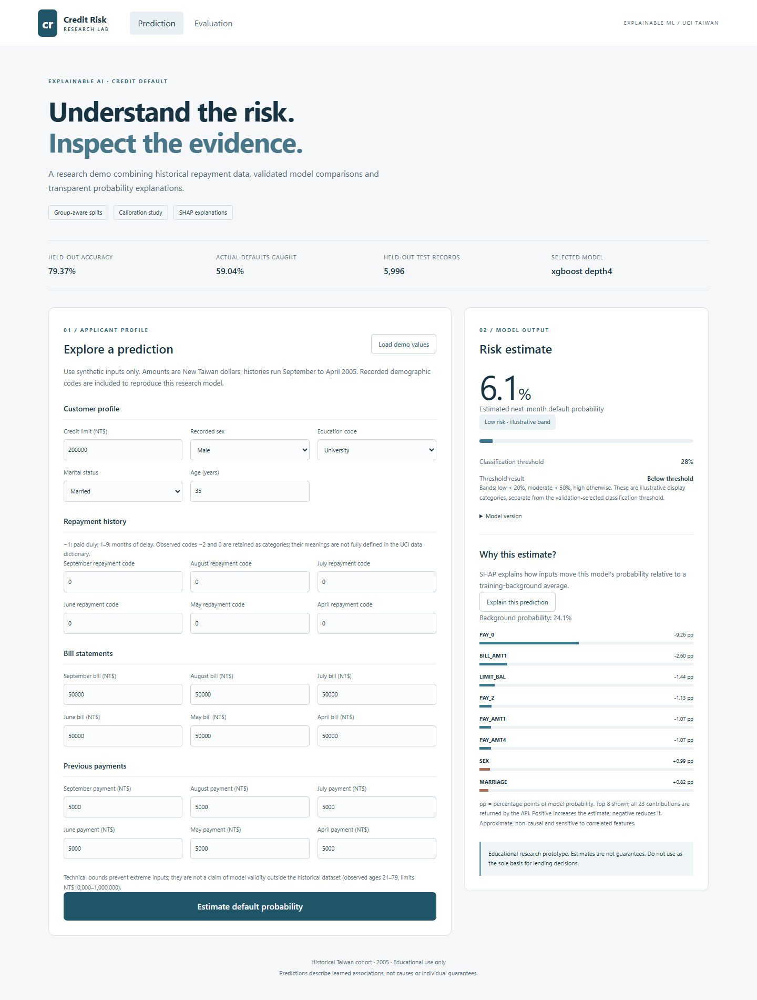
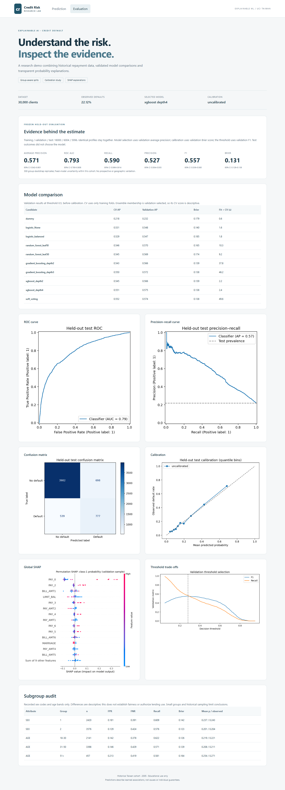

# Explainable AI-Based Credit Default Risk Prediction

An upgrade of [Sathwik's original application](https://github.com/singusathwik/Credit-Card-Risk-Prediction), retaining Flask and React while correcting evaluation and inference methodology.

## Current results and practical interpretation

The application still serves the original **XGBoost** model. The latest trained **LightGBM candidate** adds repayment-behavior features and uses all 24,004 non-test records for development. Both results below refer to the same 5,996 test records.

| Metric | Active XGBoost | Latest LightGBM candidate |
|---|---:|---:|
| Accuracy | 79.37% | **79.47%** |
| Default recall | **59.04%** | 58.51% |
| Precision | 52.68% | **52.92%** |
| ROC AUC | 0.7930 | **0.7936** |
| Average precision | 0.5708 | **0.5796** |

**How good are these results?** They support an educational or portfolio demonstration of reproducible modeling and explanations, but do not establish readiness for real lending or state-of-the-art predictive performance. Predicting “no default” for every test record would achieve **78.05% accuracy while catching no defaults**, so accuracy alone is insufficient. The candidate catches about **59 of every 100 actual defaults**, misses about **41**, and approximately **53% of its flagged clients actually default**.

The candidate's **+0.10 percentage-point accuracy gain** costs **0.53 points of recall**: 13 fewer false alarms, 7 more missed defaults, and 6 additional correct classifications. Its paired 95% accuracy-change interval is **−0.37 to +0.55 percentage points**, which includes zero. It did not meet the predefined +0.5-point adoption margin, so it has **not replaced the active model**.

The candidate and threshold were frozen before this audit; test records were excluded from fitting and selection. However, the benchmark's original result was already known, so this is **not fresh external validation**. [Full candidate report and reproducibility evidence](reports/full-development-004/REPORT.md).

## Overview and problem statement
Estimate next-month default probability from historical credit-card records and inspect the evidence. This project demonstrates reproducible comparisons, calibration assessment, threshold trade-offs and SHAP. It is an **educational research prototype**, not a lending decision system. The principal gain is methodological correctness; no controlled legacy accuracy improvement or state-of-the-art claim is made.

## Dataset and target
30,000 Taiwan customers, 23 predictors, 6,636 defaults (22.12%). Target: `default payment next month` (1=default). Histories cover April–September 2005; ID is excluded. The 56 repeated predictor profiles stay grouped across partitions. [Dataset card and acquisition](docs/DATASET_CARD.md) · [UCI source](https://archive.ics.uci.edu/dataset/350/default+of+credit+card+clients).

## Architecture
```text
UCI workbook -> grouped train/validation/test -> fold-local sklearn pipelines
 -> validation selection + calibration + threshold -> full saved pipeline
 -> Flask predict / explain APIs -> React dashboard
 -> frozen test evaluation -> JSON / CSV / charts / model card
```
[Architecture and features](docs/ARCHITECTURE.md) · [Baseline audit](docs/BASELINE_AUDIT.md).

## Active model methodology
- 18,000 training / 6,004 validation / 5,996 test rows; seed 42, profile/ID groups.
- Three-fold group-aware training CV; fitted preprocessing stays in each fold.
- Validation average precision selects the model; training-CV calibration is selected by validation Brier; validation F1 selects threshold 0.28.
- One-hot nominal/status codes, train-fitted imputation/scaling and eight historical summaries. Class weighting is compared; no categorical SMOTE.
- Test scores do not choose the model, calibration or threshold. Structured JSON/CSV provide experiment tracking.

## Original model comparison
| Candidate | Training CV AP (mean ± SD) | Validation AP | Brier | Fit + CV seconds |
|---|---:|---:|---:|---:|
| dummy | 0.2181 ± 0.0023 | 0.2323 | 0.1786 | 0.6 |
| logistic_None | 0.5315 ± 0.0167 | 0.5480 | 0.1401 | 1.6 |
| logistic_balanced | 0.5289 ± 0.0179 | 0.5469 | 0.1845 | 1.8 |
| random_forest_leaf10 | 0.5460 ± 0.0210 | 0.5695 | 0.1646 | 10.3 |
| random_forest_leaf30 | 0.5447 ± 0.0232 | 0.5690 | 0.1742 | 9.2 |
| gradient_boosting_depth2 | 0.5434 ± 0.0192 | 0.5660 | 0.1391 | 37.8 |
| gradient_boosting_depth3 | 0.5504 ± 0.0160 | 0.5722 | 0.1384 | 46.2 |
| xgboost_depth2 | 0.5446 ± 0.0186 | 0.5658 | 0.1388 | 2.2 |
| xgboost_depth4 | 0.5510 ± 0.0159 | 0.5747 | 0.1380 | 2.4 |
| soft_voting | 0.5522 ± 0.0163 | 0.5744 | 0.1381 | 49.6 |

Selected **XGBoost depth 4**. Voting offered no validation improvement. Sigmoid/isotonic were compared; original probabilities had the lowest validation Brier. Calibration was evaluated, not assumed to help. [Full experiments](docs/EXPERIMENTS.md).

## Explainable AI
`POST /explain` returns SHAP contributions to the exact served default probability. Positive/negative values increase/decrease the estimate relative to 24 training-background rows. UI shows percentage points, not log odds. Global plots use 30 validation observations. Additivity is checked; explanations remain approximate and non-causal. [Model card](docs/MODEL_CARD.md).

## Active model evaluation results
| Metric | Held-out test | 95% group-bootstrap CI |
|---|---:|---|
| accuracy | 0.7937 | 0.7835–0.8046 |
| precision | 0.5268 | 0.5035–0.5546 |
| recall | 0.5904 | 0.5660–0.6142 |
| f1 | 0.5568 | 0.5362–0.5797 |
| macro_f1 | 0.7112 | 0.6996–0.7249 |
| roc_auc | 0.7930 | 0.7803–0.8076 |
| average_precision | 0.5708 | 0.5416–0.6013 |
| balanced_accuracy | 0.7206 | 0.7082–0.7338 |
| brier | 0.1309 | 0.1255–0.1361 |
| false_positive_rate | 0.1491 | 0.1385–0.1592 |
| false_negative_rate | 0.4096 | 0.3858–0.4340 |

Threshold 0.28; confusion matrix `[[3982, 698], [539, 777]]` (truth rows, predicted columns). At 0.50 accuracy is 82.39% with recall 36.25%; the selected threshold is a validation F1 compromise. Historical 81.32% lacks its model artifact and used test-based selection, so it is not directly comparable.

[Evaluation](reports/run-001/EVALUATION.md) · [JSON results](reports/run-001/evaluation.json) · [Technical report](docs/TECHNICAL_REPORT.md).

## Further accuracy–recall research
The [behavioral-feature and full-development follow-up](reports/full-development-004/REPORT.md) produced a LightGBM candidate with **79.47% accuracy / 58.51% default recall**, versus the incumbent's **79.37% / 59.04%** on the same 5,996 records. The +0.10-point accuracy gain is small and its paired interval includes zero. This candidate uses new repayment-history features and 24,004 development records; its model/threshold were frozen before a single audit on the previously reported test benchmark. It did not meet the predefined +0.5-point adoption margin, so the default remains the incumbent. The trained candidate is available locally at `artifacts/full-development-004/serving.joblib`; model files are not published.

**Earlier two follow-ups:** neither met the replacement criteria. Native categorical boosting with a stricter recall target achieved 77.91% accuracy / 60.43% recall in nested CV versus the incumbent's 78.74% / 58.57% on the same folds.

The main dashboard now displays held-out accuracy and default recall directly. The evaluation page explains how many defaults are caught or missed, alongside uncertainty intervals and the full technical metrics.

The [native CatBoost follow-up](reports/native-002/REPORT.md) compares three categorical boosting configurations against the incumbent with a stricter training recall target. It is exploratory research, not a replacement test score. Run it with `python -m credit_risk.improve --profile native --selection-recall-floor 0.60 --output artifacts/native-new --report reports/native-new`.

A bounded nested, group-aware CV follow-up evaluates accuracy subject to explicit default-recall constraints. The original test partition is excluded from that search. See the [follow-up report](reports/accuracy-recall-001/REPORT.md) for the comparison, fixed protocol and replacement decision. These exploratory results do not replace the original held-out metrics above.

## Application screenshots


[Mobile view](docs/screenshots/prediction-mobile.png).

## Installation
Use **Python 3.12** and Node.js 22. Python 3.14 is unsupported by these pins because SHAP 0.50 specifies beta-only numba dependencies there.

```powershell
python -m venv .venv
.venv\Scripts\Activate.ps1
python -m pip install -r requirements.txt
npm ci
```
On Linux/macOS use `source .venv/bin/activate`. `requirements-lock.txt` additionally records the full clean Python 3.12 dependency snapshot. If absent, obtain the original workbook following the dataset card; xlrd is pinned. Do not substitute data. Export settings from `.env.example` in your shell; this application does not automatically load dotenv files.

## Training and evaluation
```bash
python train_model.py --output artifacts/run-001
python -m credit_risk.evaluate --run artifacts/run-001 --report reports/run-001
```
Existing runs and final reports are protected from overwrite. This checkout already has frozen `reports/run-001`. To reproduce, use `--output artifacts/reproduction` and then `--run artifacts/reproduction --report reports/reproduction`; set MODEL_PATH and REPORT_DIR to those paths to serve the reproduction. Do not tune against an observed test set; future optimization requires a new external holdout. Bundles include the full pipeline and background data and are ignored by Git.

## API usage
Run `python server.py`. Endpoints (also with `/api` prefix): `GET /health`, `GET /model-info`, `POST /predict`, `POST /explain`. Additional `/api/evaluation`, `/api/plots/<allowlisted-name>` and legacy `/accuracy`/`/api/accuracy` remain.

```bash
curl -H "Content-Type: application/json" --data-binary @examples/applicant.json http://127.0.0.1:5000/predict
curl -H "Content-Type: application/json" --data-binary @examples/applicant.json http://127.0.0.1:5000/explain
```
Use `curl.exe` if PowerShell aliases curl. Supply exactly 23 raw fields. Invalid/missing/non-finite values return 400, wrong media type 415, unavailable model 503, busy explanations 429. Responses include probability, label, threshold, illustrative bands and version. No applicant records are stored by application code.

## Running the frontend
```bash
npm run build
python server.py
```
Open http://127.0.0.1:5000. Waitress serves React and APIs. For development run `npm run dev` in another terminal and open http://localhost:3000; Vite proxies `/api` to Flask. Debug is disabled; source/data files are not static assets. CORS defaults to same-origin.

## Tests
```bash
python -m pytest -q
npm run build
npx playwright test
```
Browser tests require the trained model, frozen report, build and running server. They use installed Edge by default; set PLAYWRIGHT_CHANNEL=chromium and run `npx playwright install chromium` elsewhere. Tests exercise real predictions, SHAP reconstruction, evaluation plots, invalid-input/error states and a 390px viewport. CI runs synthetic Python tests/build without data or a fitted artifact. [Verification record](docs/VERIFICATION.md).

## Docker setup
```bash
docker build -t credit-risk .
docker run --rm -p 5000:5000 -v "$PWD/artifacts:/app/artifacts:ro" credit-risk
```
Train first with the pinned environment. The bundle is excluded from the image and mounted read-only. Container user is non-root. **Docker execution was not verified: Docker is unavailable here.** No cloud deployment was performed.

## Limitations
Historical single-country data, unmeasured drift, imperfect probabilities, no lending-cost optimum, descriptive subgroups without subgroup intervals and small SHAP samples limit conclusions. Manifests do not make untrusted pickle safe. No authentication or durable rate limiting is provided. See model and dataset cards.

## Responsible AI
Use synthetic inputs and never use this as the sole basis for real lending. Demographic fields may encode disadvantage. SHAP explains model associations, not causes; risk bands are illustrative, not policy recommendations. Evaluate external validity and relevant governance before any real-world use.

## Future research and portfolio use
Preregister cost-based objectives; evaluate new temporal/geographic cohorts; study sensitive-feature ablations, subgroup uncertainty and SHAP stability. For Master's applications, explain the leakage/inference corrections and threshold trade-offs, link the report and demo, and present this as applied ML engineering. [Verified resume bullets](docs/RESUME_BULLETS.md).

## Attribution and license
Original application: linked repository owner. Historical code/README are retained in `legacy/`; original notebook remains historical. Dataset: I-Cheng Yeh/UCI, CC BY 4.0. No explicit code license was present and this upgrade does not invent one; the owner should select one before redistribution. Model artifacts and local environments are excluded from Git; published reports contain aggregate results only.
