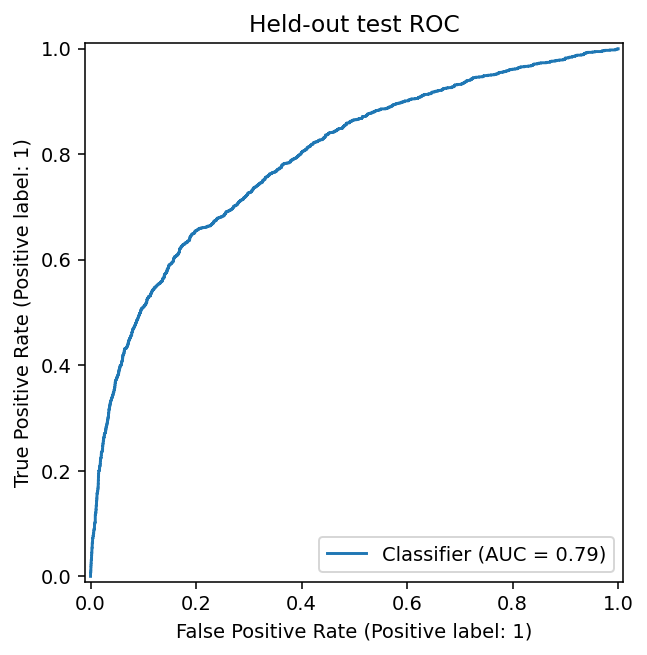
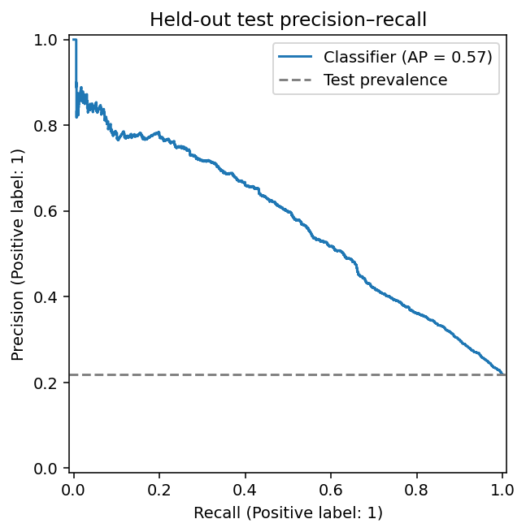
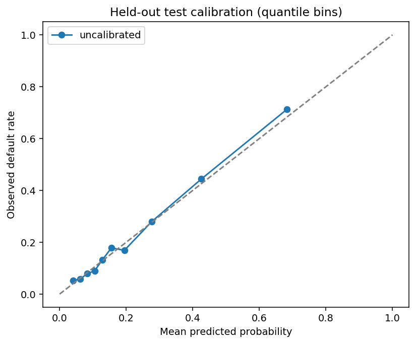
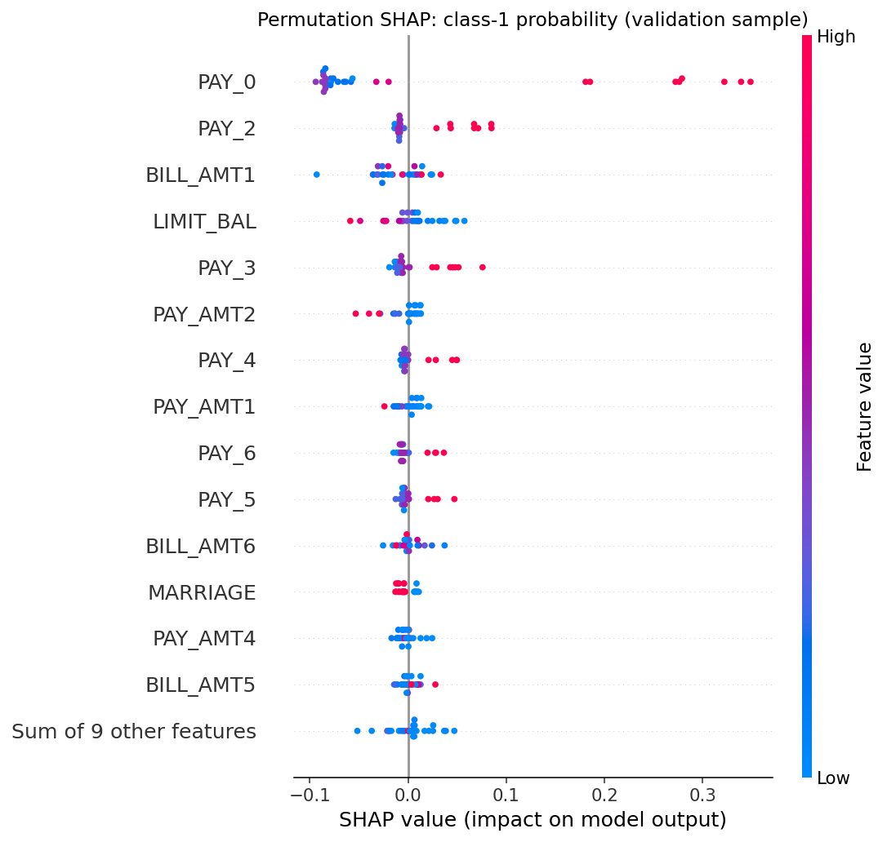

# Explainable AI-Based Credit Default Risk Prediction

## 1. Abstract
This study upgrades an existing Flask/React credit-default demo into a reproducible experiment. Correcting training/inference mismatch and test-driven selection is the central contribution. Ten configurations were compared on the available 30,000-row UCI cohort. Selected XGBoost depth 4 achieved held-out AP 0.5708, ROC-AUC 0.7930, and Brier 0.1309. Probability-space SHAP explains the exact served model. This is an engineering study, not a novel algorithm or state-of-the-art claim.

## 2. Introduction
Accuracy is insufficient when default is a minority event and inference fails to reproduce training features. The original API replaced engineered features with zeros and training selected its winner using test accuracy. The upgrade prioritizes defensible evaluation, reproducibility and explicit limitations.

## 3. Problem definition
Estimate P(next-month default=1 | historical observations) from demographic, credit-limit and six-month repayment/statement/payment information. Classification at a validation-selected threshold is secondary to ranking and reliability. The system does not estimate causal intervention effects or decide eligibility.

## 4. Related methods
Logistic regression provides a linear baseline; forests and boosted trees capture nonlinear patterns; dummy prior prediction establishes a reference. Soft voting tests whether averaging adds value. Calibration and group CV follow documented sklearn methods [3]. SHAP supplies additive attributions [2,4]. No algorithmic novelty is asserted.

## 5. Dataset
The original workbook has 30,000 historical Taiwan records, 23 predictors and 6,636 defaults [1]. Local inspection finds no missing values, unique IDs and 56 duplicate profiles. Six-month histories are columns within one cohort; there are no independent outcome cohorts for chronological evaluation. Grouping protects identical profiles from crossing splits. Unknown family/account relationships remain unobserved. See [dataset card](DATASET_CARD.md).

## 6. Preprocessing
A shared sklearn pipeline computes eight conservative row-local summaries, imputes numeric medians/categorical modes, scales numeric values and one-hot encodes nominal demographic/status codes. Every fitted transformation stays inside training folds. Nonpositive ratio denominators become missing values; negative bills are retained. ID and target are excluded. Categorical SMOTE is avoided and weighting is compared empirically.

## 7. Model development
Ten configurations cover dummy, two logistic models, two forests, two gradient-boosting models, two XGBoost models and voting. Fixed seeds and bounded search limit expense. Legacy deep stacking is archived, not represented as validated. Artifacts retain the full pipeline, training background, threshold and dependency metadata.

## 8. Experimental methodology
18,000 / 6,004 / 5,996 group-aware training/validation/test records. Three training folds measure AP; validation AP selects the model. Sigmoid/isotonic fit on training out-of-fold predictions; validation Brier selects calibration. Validation F1 selects 0.28 from a predeclared grid. No refit on validation follows selection. Test is evaluated after freezing all choices. Reusing validation for several choices causes selection bias there, which the held-out check helps assess within this cohort.

## 9. Results
| Candidate | Training CV AP (mean ± SD) | Validation AP | Brier | Fit + CV seconds |
|---|---:|---:|---:|---:|
| dummy | 0.2181 ± 0.0023 | 0.2323 | 0.1786 | 0.6 |
| logistic_None | 0.5315 ± 0.0167 | 0.5480 | 0.1401 | 1.6 |
| logistic_balanced | 0.5289 ± 0.0179 | 0.5469 | 0.1845 | 1.8 |
| random_forest_leaf10 | 0.5460 ± 0.0210 | 0.5695 | 0.1646 | 10.3 |
| random_forest_leaf30 | 0.5447 ± 0.0232 | 0.5690 | 0.1742 | 9.2 |
| gradient_boosting_depth2 | 0.5434 ± 0.0192 | 0.5660 | 0.1391 | 37.8 |
| gradient_boosting_depth3 | 0.5504 ± 0.0160 | 0.5722 | 0.1384 | 46.2 |
| xgboost_depth2 | 0.5446 ± 0.0186 | 0.5658 | 0.1388 | 2.2 |
| xgboost_depth4 | 0.5510 ± 0.0159 | 0.5747 | 0.1380 | 2.4 |
| soft_voting | 0.5522 ± 0.0163 | 0.5744 | 0.1381 | 49.6 |

| Method | Validation Brier (lower is better) |
|---|---:|
| uncalibrated | 0.138042 |
| sigmoid | 0.138334 |
| isotonic | 0.138276 |

| Metric | Held-out test | 95% group-bootstrap CI |
|---|---:|---|
| accuracy | 0.7937 | 0.7835–0.8046 |
| precision | 0.5268 | 0.5035–0.5546 |
| recall | 0.5904 | 0.5660–0.6142 |
| f1 | 0.5568 | 0.5362–0.5797 |
| macro_f1 | 0.7112 | 0.6996–0.7249 |
| roc_auc | 0.7930 | 0.7803–0.8076 |
| average_precision | 0.5708 | 0.5416–0.6013 |
| balanced_accuracy | 0.7206 | 0.7082–0.7338 |
| brier | 0.1309 | 0.1255–0.1361 |
| false_positive_rate | 0.1491 | 0.1385–0.1592 |
| false_negative_rate | 0.4096 | 0.3858–0.4340 |

Original XGBoost probabilities minimize validation Brier; additional calibration did not help. The small AP advantage over voting is not tested for significance. Confusion matrix at 0.28: [[3982, 698], [539, 777]]. At 0.50 accuracy is 82.39% but recall is 36.25%. The selected threshold retrieves more defaults at the cost of more false positives. Historical 81.32% accuracy is not a controlled comparator.

Intervals use 300 group-bootstrap replicates and omit training/selection variation. There are 698 false positives and 539 false negatives. Recorded-sex FPRs are 18.12% and 12.85%; the smaller 51+ age group has FPR 21.32%. Descriptive differences do not establish causal discrimination or significance. Aggregate errors and complete subgroup metrics are in evaluation.json.

## 10. Explainability analysis
Permutation SHAP calls the exact served probability function, including raw feature engineering and selected calibration. It uses 24 training-background rows, three permutations, and 30 sampled validation rows for global plots. PAY_0 has the largest sampled mean absolute contribution. Values are probabilities, not log odds. Maximum additivity error is 1.11e-16. This consistency check does not prove attribution stability or causality.

## 11. Limitations and ethics
One historical geographic cohort cannot establish contemporary validity. Demographic features may encode disadvantage. Group uncertainty, intersectional studies and sensitive-feature ablations remain future work. F1 omits lending costs. Correlated histories, marginal masking and a small SHAP background limit attribution interpretation. Reports publish no individual records; model bundles contain a background sample and are data-bearing. The prototype must not be the sole basis for lending. Docker configuration is provided but not executed here; no cloud deployment is claimed.

## 12. Conclusion
The contribution is consistent train/serve behavior, leakage-aware comparisons, calibration/threshold evaluation, uncertainty and SHAP in an integrated dashboard. Stronger evidence requires new temporal/geographic cohorts, preregistered operating costs and attribution/fairness studies.

## 13. References
1. Yeh, I. (2009). *Default of Credit Card Clients*. UCI Machine Learning Repository. [Dataset and dictionary](https://archive.ics.uci.edu/dataset/350/default+of+credit+card+clients), DOI: 10.24432/C55S3H.
2. Lundberg, S. M. and Lee, S.-I. (2017). *A Unified Approach to Interpreting Model Predictions*. [arXiv:1705.07874](https://arxiv.org/abs/1705.07874).
3. Scikit-learn contributors. [Probability calibration](https://scikit-learn.org/stable/modules/calibration.html), [group-aware cross-validation](https://scikit-learn.org/stable/modules/cross_validation.html#stratifiedgroupkfold), and [average precision](https://scikit-learn.org/stable/modules/generated/sklearn.metrics.average_precision_score.html).
4. SHAP contributors. [PermutationExplainer API](https://shap.readthedocs.io/en/latest/generated/shap.PermutationExplainer.html).

Sources checked 15 October 2026. Online documentation tracks current releases; experiments use requirements.txt pins.
