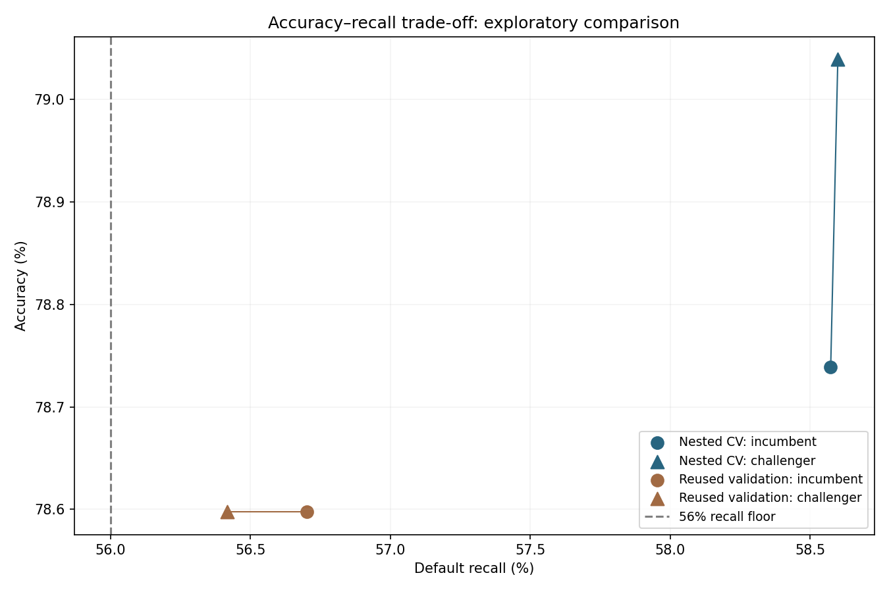

# Accuracy improvement with recall constraints

## Decision
The challenger did not pass all prespecified guardrails. The existing application model is retained; an accuracy increase alone is insufficient to justify replacing it.

The original model/report are preserved. Original test data were **not scored again**. No model change is hidden behind the old test report. The final candidate is stored only in ignored `artifacts/behavior-003/model.joblib`.

## Comparison on the same evaluation rows
| Evaluation | Baseline accuracy | Challenger accuracy | Change | Baseline recall | Challenger recall | Change |
|---|---:|---:|---:|---:|---:|---:|
| Nested grouped CV (18,000 training records) | 78.74% | 79.04% | +0.30 pp | 58.57% | 58.60% | +0.03 pp |
| Reused validation audit (6,004 records) | 78.60% | 78.60% | +0.00 pp | 56.70% | 56.42% | -0.29 pp |

Nested CV estimates the entire selection procedure: each outer fold may select a different model/threshold. The final all-training selection is **incumbent_behavior_blend**, threshold **0.285**. Validation numbers refer to that single fitted candidate and the exact saved incumbent.

Exploratory paired 95% group-bootstrap intervals on nested OOF differences:
- Accuracy change: +0.07 to +0.55 percentage points.
- Recall change: -0.57 to +0.60 percentage points.

Intervals condition on the fitted OOF predictions, ignore dependence from overlapping training sets, and do not capture retraining/model-search uncertainty. Do not interpret them as definitive population-level significance.

## Guardrail audit
| Evaluation | Prespecified requirement | Result |
|---|---|---|
| Nested CV | Accuracy gain at least 0.5 pp | Fail |
| Nested CV | Recall at least 56% | Pass |
| Nested CV | Recall loss at most 3 pp | Pass |
| Nested CV | Brier increase at most 0.005 | Pass |
| Reused validation | Accuracy gain at least 0.5 pp | Fail |
| Reused validation | Recall at least 56% | Pass |
| Reused validation | Recall loss at most 3 pp | Pass |
| Reused validation | Brier increase at most 0.005 | Pass |
| Nested CV | Accuracy-delta interval lower bound above zero | Pass |

## Protocol fixed before fitting
- Original training partition only: 18,000 records. Three grouped outer folds, each with three grouped inner folds. Identical profiles/IDs cannot cross any fold.
- Twelve fixed configurations: incumbent, two raw ordinal XGBoost controls, three XGBoost models with behavioral features, three LightGBM configurations, a histogram booster and two fixed soft-voting ensembles. Behavioral features describe historical payment coverage, limit-normalized balance flows, volatility, delay recency and consecutive delays. No IDs, target-derived features or population aggregates are used.
- No preprocessing is fitted outside its training fold. No synthetic oversampling. Histogram boosting internal early stopping is disabled, avoiding an ungrouped internal validation split.
- For each candidate, select a threshold from 0.000–1.000 in 0.005 steps on inner OOF predictions only. Maximize accuracy while recall is at least max(58%, baseline inner recall minus 3 percentage points). Ties favor higher recall.
- Select the candidate by inner constrained accuracy. Refit it on outer training and score outer validation exactly once. The incumbent architecture is also freshly fitted on each outer training set and retains threshold 0.28.
- After nested evaluation, run the same procedure on all original training rows. Freeze candidate and threshold before a single reused-validation audit; do not adapt them afterward.
- Promotion requires at least +0.5 percentage points accuracy, recall >=56%, recall loss <=3 percentage points and Brier deterioration <=0.005 on both nested CV and reused validation. Nested paired accuracy interval lower bound must exceed zero. These checks are conservative project criteria, not proof of generalization.

Protocol: [protocol.json](protocol.json). Complete aggregate results: [comparison.json](comparison.json). Individual OOF predictions, row indices and model bundles remain in ignored artifacts.

## Outer fold outcomes
| Fold | Inner-selected model | Threshold | Baseline accuracy | Challenger accuracy | Baseline recall | Challenger recall |
|---|---|---:|---:|---:|---:|---:|
| 1 | behavior_lgb_7 | 0.300 | 78.53% | 79.24% | 57.62% | 55.92% |
| 2 | incumbent_behavior_blend | 0.285 | 78.46% | 78.70% | 59.21% | 58.83% |
| 3 | behavior_lgb_7 | 0.270 | 79.23% | 79.18% | 58.89% | 61.02% |

## Final inner OOF selection (selection-biased; not test results)
| Candidate | Threshold | Accuracy | Recall | Average precision | Brier |
|---|---:|---:|---:|---:|---:|
| incumbent_xgb | 0.280 | 79.00% | 58.50% | 0.5512 | 0.1328 |
| ordinal_xgb_d3 | 0.260 | 78.56% | 58.60% | 0.5381 | 0.1338 |
| ordinal_xgb_d4 | 0.270 | 78.97% | 58.34% | 0.5382 | 0.1339 |
| behavior_xgb_d3 | 0.290 | 79.03% | 58.24% | 0.5463 | 0.1331 |
| behavior_xgb_d4 | 0.280 | 78.57% | 58.62% | 0.5436 | 0.1335 |
| behavior_xgb_d5 | 0.280 | 78.45% | 58.17% | 0.5438 | 0.1339 |
| behavior_lgb_7 | 0.290 | 79.07% | 58.09% | 0.5470 | 0.1329 |
| behavior_lgb_15 | 0.280 | 78.52% | 58.37% | 0.5453 | 0.1337 |
| behavior_lgb_31 | 0.275 | 77.89% | 58.34% | 0.5397 | 0.1351 |
| behavior_hist7 | 0.290 | 79.04% | 58.32% | 0.5467 | 0.1330 |
| behavior_blend | 0.280 | 78.61% | 58.50% | 0.5454 | 0.1335 |
| incumbent_behavior_blend | 0.285 | 79.18% | 58.24% | 0.5501 | 0.1328 |



## Interpretation and limitations
Raising a threshold often reduces false positives and increases accuracy, but can miss more defaults. A recall constraint on fitting/OOF data does **not** guarantee recall on other observations. The outer and validation checks detect this failure rather than relaxing the criteria after observing results.

The original training and validation data have already influenced earlier project choices. This nested comparison prevents direct fold leakage, but it is exploratory development evidence, not a fresh unbiased evaluation of the whole research process. Reused validation is not an independent holdout. No claim is made that the published 79.37% test accuracy has improved. A new temporal/geographic cohort is needed to establish a new test claim.

## Reproduce
With Python 3.12, the pinned requirements, original workbook and run-001 artifact:
```bash
python -m credit_risk.improve --profile behavior --selection-recall-floor 0.58 --output artifacts/behavior-new --report reports/behavior-new
python -m pytest -q
```
Use a new directory for exact reproduction; never run repeated searches against the observed test outcome. `scripts/report_improvement.py` renders this run's aggregate outputs without fitting anything.

## Method references
- [Scikit-learn: nested versus non-nested CV](https://scikit-learn.org/stable/auto_examples/model_selection/plot_nested_cross_validation_iris.html).
- [Scikit-learn: decision-threshold tuning and overfitting](https://scikit-learn.org/stable/modules/classification_threshold.html).

Feature chronology follows the [UCI variable definitions](https://archive.ics.uci.edu/dataset/350/default+of+credit+card+clients). Ratios to a preceding bill are historical proxies, not contractual repayment amounts. [LightGBM API](https://lightgbm.readthedocs.io/en/v4.6.0/pythonapi/lightgbm.LGBMClassifier.html).
