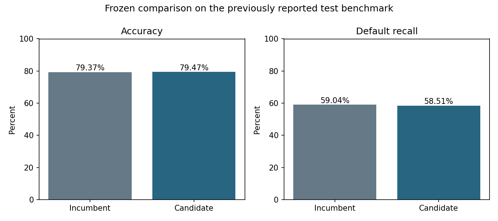

# Behavioral LightGBM: frozen final comparison

The candidate achieved **79.47% accuracy**, compared with **79.37%** for the incumbent. Recall changed from **59.04% to 58.51%**. This is a small observed improvement, not a statistically established gain. The paired fixed-prediction 95% interval for accuracy change is **-0.37 to +0.55 percentage points**.

The candidate did not meet the prespecified +0.5-point adoption margin, so the application's default remains the incumbent. The trained candidate is available locally in ignored `artifacts/full-development-004/serving.joblib`.

## Same 5,996 benchmark records
| Metric | Incumbent | Candidate | Change |
|---|---:|---:|---:|
| Accuracy | 79.37% | 79.47% | +0.10 pp |
| Default recall | 59.04% | 58.51% | -0.53 pp |
| Precision | 52.68% | 52.92% | +0.24 pp |
| F1 | 55.68% | 55.58% | -0.10 pp |
| ROC AUC | 79.30% | 79.36% | +0.05 pp |
| Average precision | 57.08% | 57.96% | +0.88 pp |

False alarms fell from **698 to 685**; missed defaults increased from **539 to 546**. That gives **6 more correct classifications**, with **13 fewer false alarms** and **7 more missed defaults**. Brier score improved from 0.13088 to 0.13024.

## What changed
- The model is LightGBM with seven leaves per tree, 350 trees, regularization and a frozen **0.284** threshold.
- Features add payment-to-prior-bill ratios, limit-normalized balances/payments/flows, recent-versus-older trends, payment variability, delay severity/recency and consecutive delays. All are row-local and use only the recorded six-month history. ID and the target are never predictors. Ratios are historical proxies, not contractual due amounts.
- All **24,004 non-test records** enter development and the final fit. The former validation partition is now training data; there is no separate 6,004-record validation claim for this model.
- Twelve fixed candidates were compared using five-fold grouped OOF predictions. Every prediction used for selection came from a model that did not train on that record or its duplicate/ID group. The threshold maximized OOF accuracy subject to a 58% recall floor (or baseline recall minus three points if larger).
- Candidate, threshold, protocol and model hash were saved **before** test scoring. A one-shot audit guard rejects repeat audits. The model was not changed after the audit. A separate serving copy corrects inherited prevalence/dependency metadata; the frozen fitted bundle and audit remain immutable.

## Limits
The original test benchmark's baseline result had already been reported, and earlier development experiments influenced this work. No test observations entered fitting or model/threshold selection, but the benchmark is not fresh external evidence. Bootstrap intervals exclude training/search uncertainty and benchmark reuse bias. Further tuning must not use these test outcomes. A new cohort is needed for independent confirmation.

The change also combines feature engineering, a different estimator and more training records. This comparison does not isolate the causal contribution of each change. Training gain importance is descriptive, not causal.

## Development selection (selection-biased, not test results)
| Candidate | Threshold | OOF accuracy | OOF recall |
|---|---:|---:|---:|
| incumbent_xgb | 0.276 | 78.55% | 58.05% |
| ordinal_xgb_d3 | 0.260 | 78.31% | 58.01% |
| ordinal_xgb_d4 | 0.265 | 78.37% | 58.14% |
| behavior_xgb_d3 | 0.284 | 78.96% | 58.06% |
| behavior_xgb_d4 | 0.282 | 78.84% | 58.10% |
| behavior_xgb_d5 | 0.281 | 78.69% | 58.31% |
| behavior_lgb_7 | 0.284 | 78.98% | 58.01% |
| behavior_lgb_15 | 0.283 | 78.71% | 58.10% |
| behavior_lgb_31 | 0.282 | 78.26% | 58.01% |
| behavior_hist7 | 0.281 | 78.87% | 58.05% |
| behavior_blend | 0.283 | 78.80% | 58.01% |
| incumbent_behavior_blend | 0.281 | 78.97% | 58.18% |

## Reproduce
```powershell
.venv-clean\Scripts\python.exe -m credit_risk.finalize train --output artifacts/full-new --report reports/full-new
.venv-clean\Scripts\python.exe -m credit_risk.finalize audit --output artifacts/full-new --report reports/full-new
```
Use a new directory. Do not rerun the audit as a tuning loop. The committed frozen sources preserve the exact audited implementation; current training code additionally corrects descriptive metadata before saving.

Evidence: [protocol](protocol.json), [frozen choice](frozen_selection.json), [audit](audit.json), [verification](verification.json), [training feature importance](feature_importance.json), [earlier nested feature experiment](../behavior-003/REPORT.md).

References: [UCI variable chronology](https://archive.ics.uci.edu/dataset/350/default+of+credit+card+clients), [LightGBM 4.6 API](https://lightgbm.readthedocs.io/en/v4.6.0/pythonapi/lightgbm.LGBMClassifier.html).


